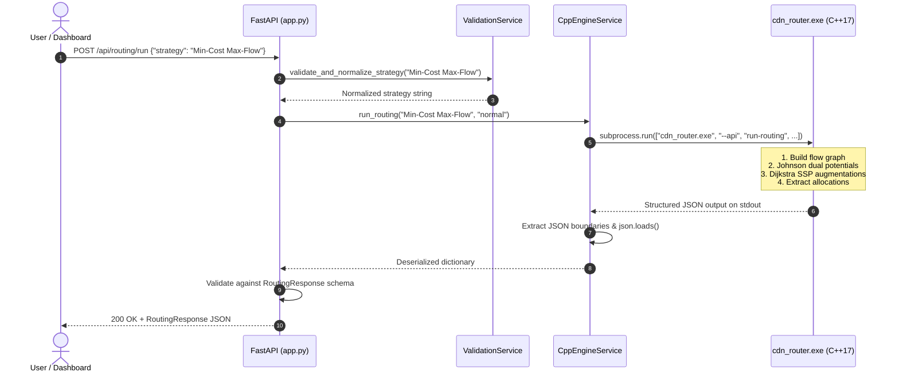

# System Architecture & Technical Design

**Adaptive CDN Traffic Router**  
*Comprehensive architecture specification detailing the tripartite design: C++17 Core Engine, Python FastAPI Bridge, and Web Dashboard.*

---

## 1. High-Level Architectural Overview

The Adaptive CDN Traffic Router employs a modular, three-tier architecture separating high-performance algorithmic optimization from API orchestration and user interface rendering:

```mermaid
graph TD
    subgraph Tier 1: Client & Presentation
        UI["Web Dashboard (Phase 10)<br>HTML5 / Vanilla JS / Chart.js"]
    end

    subgraph Tier 2: Backend Bridge (Phase 9)
        API["FastAPI REST Application<br>(Port 8000)"]
        VAL["Validation Service<br>(Input Sanitization & Normalization)"]
        MODELS["Pydantic Models<br>(Requests & Responses)"]
        SUBP["C++ Subprocess Bridge<br>(Safe stdio Execution, shell=False)"]
    end

    subgraph Tier 3: Core C++17 Engine
        CLI["C++ API Handler<br>(--api get-network | run-routing | run-scenario)"]
        ROUTER["Router Coordinator & FailureHandler"]
        MCMF["Min-Cost Max-Flow Engine<br>(Johnson Dual Potentials + Dijkstra)"]
        BASE["Baseline Heuristics<br>(Round Robin, Nearest Server, Greedy Cost)"]
        GRAPH["5-Tier Flow Graph<br>(Parallel Convex Load Bands & Origin)"]
        SIM["Network Simulator<br>(Spikes, Congestion, Outages)"]
        SUPPORT["Supporting Algorithms<br>(Edmonds-Karp, Min-Cut, DP Knapsack, Holt)"]
    end

    UI -->|HTTP / JSON REST API| API
    API --> VAL
    VAL --> MODELS
    API --> SUBP
    SUBP -->|Safe argv execution| CLI
    CLI --> ROUTER
    CLI --> BASE
    ROUTER --> MCMF
    BASE --> GRAPH
    MCMF --> GRAPH
    CLI --> SIM
    CLI --> SUPPORT
    CLI -.->|Pure JSON stdout| SUBP
    SUBP -.->|Parsed Models| API
    API -.->|JSON Responses| UI
```

---

## 2. Layer Responsibilities & Guarantees

### Tier 1: Core C++17 Engine (Single Source of Truth)
- **Role:** Executes all algorithmic computations, flow network transformations, successive shortest path augmentations with Johnson dual potentials, baseline heuristic routing, Knapsack DP caching, and Holt demand forecasting.
- **Single Source of Truth Principle:** Python NEVER recalculates or overrides routing allocations. Every allocation, server utilization, link cost, and fallback decision originates strictly within the compiled C++17 binary.
- **Interchange Interface:** Standardized `--api <action> [args...]` CLI interface emitting clean, machine-readable JSON to `stdout`.

### Tier 2: Python FastAPI Backend Bridge (Phase 9)
- **Role:** Provides high-throughput, non-blocking asynchronous REST endpoints, enforces schema validation through Pydantic V2 models, sanitizes inputs, orchestrates scenario executions, and handles errors gracefully.
- **Safety & Process Isolation:**
  - Invokes `cdn_router.exe` using `subprocess.run` with `shell=False` and positional argument lists, eliminating any potential for shell injection.
  - Implements process timeout protection ($10.0\text{ seconds}$) preventing hung processes from exhausting server resources.
  - Features JSON payload boundary extraction: robustly scans `stdout` for valid `{...}` or `[...]` boundaries, ensuring zero parsing failures even if external logger output is present.
- **Modular Directory Organization:**
  ```text
  backend/
  ├── app.py              # Main FastAPI application & CORS configuration
  ├── requirements.txt    # Production dependencies
  ├── routes/             # Feature-specific API route controllers
  │   ├── routing.py      # POST /api/routing/run
  │   ├── simulation.py   # POST /api/simulation/run
  │   ├── scenarios.py    # POST /api/scenarios/run
  │   └── benchmarks.py   # GET /api/benchmarks & /api/benchmarks/{id}
  ├── services/           # Business logic & C++ engine execution
  │   ├── cpp_engine.py   # Subprocess runner & JSON parser
  │   └── validation.py   # Input normalization & bounds checking
  ├── models/             # Pydantic data schemas
  │   ├── requests.py     # Request payload schemas
  │   └── responses.py    # Response serialization schemas
  └── tests/              # Automated pytest suite
      └── test_api.py     # 20 full-coverage unit & integration tests
  ```

### Tier 3: Frontend Web Dashboard (Planned - Phase 10)
- **Role:** Interactive control room visualizer consuming `/api/network`, `/api/routing/run`, `/api/scenarios/run`, and `/api/benchmarks` to render real-time node graphs, load distribution bar charts, latency dials, and comparative benchmark radar charts.

---

## 3. Data Flow Sequence



---

## 4. Error Handling and Fault Resilience

| Failure Mode | Detection Mechanism | System Response | HTTP Code |
| :--- | :--- | :--- | :--- |
| **Missing Binary** | Path existence check in `_find_executable()` | Informative error directing user to compile C++ engine | `500 Internal Server Error` |
| **Engine Timeout** | `subprocess.TimeoutExpired` ($> 10.0\text{s}$) | Halts subprocess and reports timeout | `504 Gateway Timeout` |
| **Invalid Strategy** | Whitelist lookup in `validation.py` | Returns supported strategy list in message | `400 Bad Request` |
| **Invalid Scenario** | Whitelist lookup in `validation.py` | Returns valid scenario keys in message | `400 Bad Request` |
| **Out-of-Bounds Input**| Bounds check (e.g. spike $\le 0$ or $> 10$) | Explains numeric constraint | `400 Bad Request` |
| **Malformed JSON** | `json.JSONDecodeError` handler | Captures raw preview of bad output stream | `500 Internal Server Error` |

