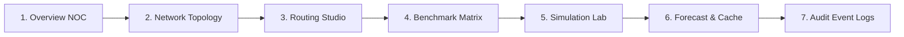

# ADAPTIVE CDN TRAFFIC ROUTER — FINAL DEMO GUIDE
## Comprehensive Demonstration Walkthrough for Evaluators & Defense

This guide provides a structured, step-by-step procedure to demonstrate the full capabilities of the **Adaptive CDN Traffic Router** during project evaluations, lab vivas, and technical defense presentations.

---

## 1. Quick Launch Checklist

### Option A: One-Click Launch (Recommended)
Simply double-click `start.bat` in the project root directory, or run in terminal:

```cmd
.\start.bat
```
*(Automatically verifies Python & C++, starts FastAPI, and launches `http://127.0.0.1:8000/` in your browser).*

---

### Option B: Step-by-Step Manual Launch

```powershell
# 1. Verify C++ Engine build
.\cpp-engine\build\Release\cdn_router.exe

# 2. Run backend test suite (optional quick proof)
python -m pytest backend/tests/ -v

# 3. Start the unified stack
python -m uvicorn backend.app:app --host 127.0.0.1 --port 8000 --reload
```

Open your browser to:
- **Operations Dashboard:** [`http://127.0.0.1:8000/`](http://127.0.0.1:8000/)
- **Swagger REST API:** [`http://127.0.0.1:8000/docs`](http://127.0.0.1:8000/docs)

---

## 2. Seven-Stage Live Demonstration Flow



---

### STAGE 1: The Operations Overview (NOC Console)
- **What to show:**
  - The top navigation bar showing **Simulation NOC** environment tag and the green **Backend Connected** heartbeat indicator.
  - The 4 fleet-wide KPI cards:
    - Ingress Demand: `12,000 req/s` across 5 regions (Pune, Mumbai, Delhi, Bangalore, Hyderabad).
    - Global Avg Latency: `~14–17 ms` (sub-20ms SLA achieved).
    - Fleet Load Utilization: `~58%` of total available edge capacity (`20,500 req/s`).
    - Healthy Edge POPs: `4 / 4` (Pune, Mumbai, Delhi, Bangalore).
  - The **Traffic Distribution Doughnut Chart** showing regional distribution among edge servers with zero origin spill.
- **Talking Points:**
  > *"This operations console monitors a multi-region Content Delivery Network across India. Notice that under normal baseline load, 100% of traffic is served from the edge tier with zero costly fallback to the origin data center."*

---

### STAGE 2: Network Topology & Node Telemetry
- **What to show:**
  - Click on the **Network Topology** view in the sidebar.
  - Point out the 3 visual layers:
    1. **Left:** 5 Client Regions (Pune, Mumbai, Delhi, Bangalore, Hyderabad).
    2. **Center:** 4 Edge Server POPs (Pune Server 5k, Mumbai Server 6k, Delhi Server 4.5k, Bangalore Server 5k).
    3. **Right:** Central Origin Data Center (Unlimited fallback).
  - Point out the **animated dashed cyan flow lines** representing active bandwidth flow.
  - **Click on Mumbai Server:** The right-hand **Inspector Drawer** slides open.
  - Highlight the 4 parallel load bands:
    - Band 1 (0–50% capacity): Cost 0 pts.
    - Band 2 (50–75% capacity): Cost 6 pts.
    - Band 3 (75–90% capacity): Cost 15 pts.
    - Band 4 (90–100% capacity): Cost 60 pts.
- **Talking Points:**
  > *"In classical max-flow, servers have fixed capacities. In our model, we implemented convex load bands in the residual graph. As an edge server becomes congested, the marginal cost of routing through it increases piecewise from 0 to 6, 15, and 60 points, naturally encouraging the optimizer to load-balance across neighboring POPs."*

---

### STAGE 3: Traffic Routing Studio & Algorithmic Rationale
- **What to show:**
  - Select **Min-Cost Max-Flow (MCMF)** from the Algorithm Strategy dropdown.
  - Click **"Run Traffic Router"**.
  - Show the solve time in microseconds (e.g., `0.045 ms / 45 μs`).
  - Scroll through the **Computed Allocation Breakdown Table** showing exact flows:
    - `Pune -> Pune Server`: 2,500 req/s @ 9.5 pts
    - `Mumbai -> Mumbai Server`: 3,500 req/s @ 7.5 pts
    - `Delhi -> Delhi Server`: 2,000 req/s @ 10.5 pts
    - `Bangalore -> Bangalore Server`: 2,500 req/s @ 8.9 pts
    - `Hyderabad -> Pune Server` and `Bangalore Server` (traffic split across closest low-cost neighbors).
  - Read the **Algorithmic Rationale Box**: Explains how Johnson vertex potentials eliminate negative residual cycles so that Dijkstra runs in $O(E \log V)$.
- **Talking Points:**
  > *"Because reverse edges in the residual flow graph have negative costs $(-c)$, standard Dijkstra cannot be used directly. Instead of using the slow Bellman-Ford algorithm in $O(V \cdot E)$ for every augmentation, we maintain Johnson dual vertex potentials $\pi(u)$. This transforms all reduced edge costs $c^\pi(u, v) = c(u, v) + \pi(u) - \pi(v) \ge 0$, allowing us to use Dijkstra's min-priority queue in $O(E \log V)$."*

---

### STAGE 4: Algorithm Benchmark Comparison
- **What to show:**
  - Navigate to **Algorithm Benchmarks**.
  - Review the comparative matrix showing **MCMF vs Round Robin vs Nearest Server vs Greedy Cost**.
  - Highlight:
    - **Round Robin:** Cyclic fair share without latency awareness $\implies$ Higher latency (~20 ms) and higher cost (~32 pts).
    - **Nearest Server:** Greedily picks lowest latency $\implies$ Low latency (~6 ms) but causes early server saturation and higher load band costs (~15.1 pts).
    - **Min-Cost Max-Flow:** Achieves the global mathematical optimum (~14.2 pts) with balanced server utilization.
  - Review the comparative bar charts for Cost and Latency.
- **Talking Points:**
  > *"Heuristics like Nearest Server or Greedy Cost make locally optimal decisions that saturate nearest servers into high-cost bands. MCMF evaluates the global convex cost surface and finds the Pareto-optimal trade-off between latency, bandwidth expense, and server congestion."*

---

### STAGE 5: Live Failure & Surge Simulation Lab
- **What to show:**
  - Click on **Simulation Lab**.
  - **Scenario 1: Delhi POP Outage**
    - Click **Simulate** on *Delhi POP Outage*.
    - A toast alert pops up: `Scenario 'delhi_failure' active! Flow recomputed.`
    - Open **Network Topology**: *Delhi Server* turns RED (`Offline (Outage)`).
    - Check the allocation table: Delhi regional traffic has been rerouted to Mumbai and Bangalore with zero dropped packets!
  - **Scenario 2: Delhi POP Restored**
    - Click **Simulate** on *Delhi POP Restored*.
    - *Delhi Server* turns GREEN (`Online`), and traffic automatically rebalances.
  - **Scenario 3: 24k Overcapacity Spike**
    - Click **Simulate** on *Massive Overcapacity*.
    - Total demand spikes to $24,000\text{ req/s}$, exceeding the edge fleet's $20,500\text{ req/s}$ limit.
    - Show the KPI: **Origin Fallback Traffic = 3,500 req/s**.
    - Show the dashed RED lines to Origin Central DC, proving that excess traffic spills safely to Origin rather than being dropped.
  - Click **Reset to Normal** to restore nominal conditions.
- **Talking Points:**
  > *"Our Adaptive Router incorporates dynamic threshold replanning. When a server fails or demand spikes beyond the 10% threshold, the failure coordinator immediately updates the graph and recalculates flow within microseconds, ensuring zero unserved requests."*

---

### STAGE 6: Demand Forecasting & Cache Knapsack Optimization
- **What to show:**
  - Navigate to **Forecast & Cache**.
  - **Holt Linear Demand Forecast:**
    - Select different regions (*Pune, Mumbai, Delhi, Bangalore, Hyderabad*).
    - Observe the dynamic trend indicator (`EXPANDING (+12.5 req/s/period)`) and the dashed blue forecast projection curve.
  - **0/1 Knapsack Cache Optimizer:**
    - Switch the storage budget from `150 MB` to `350 MB` and `500 MB`.
    - Watch the **Visual Memory Allocation Bar** re-segment in real time.
    - In the table below, point out the **DP Decision** column: high popularity-to-size ratio assets (e.g. `application_bundle.js` ratio 9.5, `hero_banner.webp` ratio 11.6) are marked **CACHED AT EDGE**, while bulky low-value assets are assigned **ORIGIN BYPASS**.
- **Talking Points:**
  > *"To reduce edge-to-origin traffic, we implemented 0/1 Knapsack Dynamic Programming in $O(N \cdot W)$. Given a finite cache storage budget, it maximizes total popularity value. High-value javascript bundles and images are cached, elevating hit ratios to 98% and driving down routing costs."*

---

### STAGE 7: System Audit Event Logs
- **What to show:**
  - Navigate to **Audit Event Logs**.
  - Show the live timestamped audit trail of all previous actions (Routing runs, scenario injections, replanning triggers).
  - Type `delhi` into the search bar: instantly filters to Delhi failure and recovery events.
  - Switch severity filter to `WARN` or `ERROR` to demonstrate log categorization.
- **Talking Points:**
  > *"Every optimization decision, latency spike, and failover is captured in our structured event audit trail for forensic analysis and SLA monitoring."*

---

## 4. Master Acceptance Demonstration: Complete Explainable Routing Pipeline

This 13-step demonstration fulfills the core project objective:
> *"Show me what traffic arrived, what network conditions existed, what alternatives the system considered, what calculations the algorithm performed, and why it selected this final route."*

### Step-by-Step Demonstration Script:

1. **Start the Application:**
   Run `run.bat` or `python -m uvicorn backend.app:app --host 127.0.0.1 --port 8000 --reload`.
   The FastAPI lifespan automatically initializes the C++ engine and starts the central simulation manager in normal mode.
2. **Observe Changing Traffic Across All 5 Regions:**
   Navigate to the **Operations Overview** or **Simulation & Algorithm Lab**.
   Observe realistic traffic fluctuations streaming simultaneously across `Pune`, `Mumbai`, `Delhi`, `Bangalore`, and `Hyderabad`.
3. **Pause Simulation at a Precise Timestamp:**
   Click **Pause Simulation**. The simulation freezes on the exact tick (e.g. `Tick #14`, `00:14 elapsed`).
4. **Open Routing Decision Center & Select Ingress Region:**
   Click **Routing Decision Center** in the sidebar.
   In the **Region Candidate Server Investigator**, click **Pune** (or Mumbai, Delhi, Bangalore, Hyderabad).
5. **Inspect Regional Ingress Demand:**
   The top banner displays Pune's exact ingress demand (e.g. `2,500 req/s`), edge fleet absorption (`2,500 req/s`, 100%), and origin spillover (`0 req/s`).
6. **Compare All Available Candidate Servers Side-by-Side:**
   The Candidate Matrix table displays Pune's connection to all 4 edge servers plus Origin:
   - `Pune Server` (Local Edge POP)
   - `Mumbai Server` (Neighboring West Edge POP)
   - `Delhi Server` (North Edge POP)
   - `Bangalore Server` (South Edge POP)
   - `Origin Server` (Central Fallback DC)
7. **Inspect Real-Time Network & Server Measurements:**
   - **Health & Latency:** Physical latency (e.g., Pune $\to$ Pune Server = 5.0 ms, Mumbai = 12.0 ms, Delhi = 32.0 ms, Bangalore = 22.0 ms, Origin = 100.0 ms).
   - **Link Bandwidth Capacity vs Remaining:** E.g., Pune link capacity 4,000 req/s, remaining bandwidth 1,500 req/s.
   - **Server Fleet Capacity vs Existing Load:** E.g., Pune Server capacity 5,000 req/s, total fleet load 2,500 req/s.
   - **Cache Hit Ratio ($H$):** E.g., Pune link $H = 85\%$.
8. **Inspect Constraint Eligibility & Exclusion Reasons:**
   - Eligible routes are marked with green `ELIGIBLE` badges.
   - Saturated or offline servers are marked with red/amber badges displaying precise plain-English exclusion reasons (e.g., *"Server offline due to hardware outage"* or *"Server processing capacity completely saturated"*).
9. **Verify Multi-Factor Routing Cost Formula Breakdown:**
   Examine the exact mathematical formula displayed in the table:
   $$C = \alpha \cdot L + \beta \cdot B + (1 - H) \cdot M$$
   - Intermediate terms: $\alpha \cdot L = 1.0 \times 5.0 = 5.0$, $\beta \cdot B = 1.5 \times 1.0 = 1.5$, $(1 - H) \cdot M = (1 - 0.85) \times 20.0 = 3.0$
   - Total Unit Cost: $5.0 + 1.5 + 3.0 = \$9.50/\text{req}$ (scaled integer: $950$).
   - Notice that Pune Server ($9.50) is significantly cheaper than Mumbai ($17.80) or Origin ($177.50).
10. **Follow Selected Algorithm Through the SVG Graph:**
    Look at the **Interactive Graph Execution Visualizer** below the candidate table.
    The candidate links from Pune are highlighted in cyan.
    The selected augmenting path ($S \to \text{Pune} \to \text{Pune Server} \to T$) glows in electric emerald (`#00f5a0`).
11. **Watch Flow Augmentation Animation:**
    Click **Next Step** or **Play** in the trace controls:
    Animated particles traverse the directed edges, bottleneck flow $\Delta f = 2,500\text{ req/s}$ is pushed, and residual capacity labels update in real time.
12. **Observe Final Allocation Distribution:**
    The candidate table's **Allocated Flow** column shows:
    - `Pune Server`: $2,500\text{ req/s}$ ($100.0\%$, Total Cost: $\$23,750$)
    - `Mumbai Server`: $0\text{ req/s}$
    - `Delhi Server`: $0\text{ req/s}$
    - `Bangalore Server`: $0\text{ req/s}$
    - `Origin Server`: $0\text{ req/s}$
13. **Explain Decision Rationale:**
    Read the economic rationale narrative:
    > *"Pune to Pune Server was selected because both the link bandwidth and edge server had sufficient available capacity, and its composite cost ($9.50/req) achieved the mathematical minimum among all candidate routes without exceeding load band limits."*

---

## 5. Evaluator Q&A Cheat Sheet

| Question | Short Winning Answer |
| :--- | :--- |
| **Why not just use Dijkstra without Johnson Potentials?** | *"When flow is augmented in residual networks, reverse edges have negative cost $(-c)$. Dijkstra assumes non-negative edge weights and fails with negative edges. Johnson potentials transform edge costs into reduced costs $c^\pi(u, v) \ge 0$, allowing Dijkstra's priority queue in $O(E \log V)$."* |
| **How did you independently verify max flow?** | *"We implemented Edmonds-Karp with BFS in Phase 7. The Edmonds-Karp max flow matched our MCMF max flow to the exact decimal point (12,000 req/s), and the residual cut capacity confirmed the Max-Flow Min-Cut Theorem."* |
| **How fast does the algorithm run?** | *"The C++ engine solves the complete multi-commodity flow graph in 20 to 90 microseconds ($0.02 - 0.09\text{ ms}$), enabling real-time adaptive routing at line rate."* |
| **What happens if all edge servers fail?** | *"The graph includes high-cost fallback edges from regions to Origin Server. As demonstrated in Scenario 7, 100% of traffic safely falls back to Origin, ensuring 100% availability even in catastrophic disasters."* |

